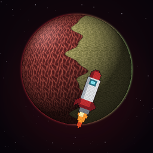

# Scape and Run: Galacticraft

An add-on for **Scape and Run: Parasites** and **Galacticraft** that carries the parasite plague off Earth and into space.

It adds **Xenosis**, a Tier 3 planet that has already been consumed by the parasites. Xenosis is a habitable, Earth-like world of infested soil, parasite growths, and two distinct strains of the infestation — a destination for players who have mastered the early game and want to face the invasion at its height.

## Features

- **A new planet to explore.** Reach Xenosis with a Tier 3 rocket. It has a breathable atmosphere and Earth-like gravity, so you can walk its surface without oxygen gear.
- **An infection already in full swing.** Xenosis begins at an advanced stage of Scape and Run's evolution instead of a clean, untouched world.
- **Parasites that stay where they belong.** On first arrival, an infestation foothold takes root near your landing site. Parasites appear only inside infested territory, the same rule Scape and Run applies everywhere else, so the planet is dangerous rather than uniformly lethal.
- **Two biome variants.** The surface is divided between the dark red Shrouded wastes and the sickly green Harlequin growths. The ground, the plant life, and even the color of the fog change as you cross from one into the other.
- **Built from Scape and Run's own content.** Terrain and decoration use the mod's own blocks and growths, so Xenosis feels like a natural part of the infection rather than a reskin.
- **Part of the greater invasion.** Xenosis counts as an infected dimension for Scape and Run's evolution and development systems.
- **Configurable.** The dimension ID, required rocket tier, starting evolution phase, the size of the initial infestation, and roughly how much of the planet is Harlequin can all be adjusted in the config file.

## Requirements

- Galacticraft Legacy
- Scape and Run: Parasites

## License

GPLv3
